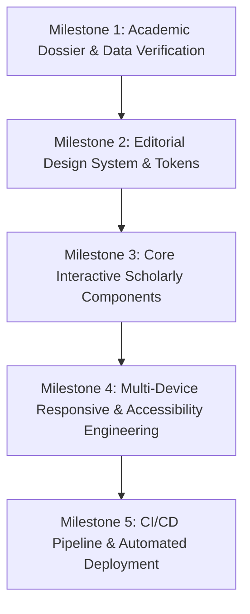

# 🏛️ Dr. S. Viswanadha Raju — Academic Legacy & Leadership

> **An editorial, responsive web experience documenting three decades of engineering pedagogy, doctoral mentorship, patented algorithmic innovation, and university leadership.**

[](https://github.com/VenkatAsrith/SVRaju-sir-Portfolio/actions/workflows/deploy.yml)
[](https://vitejs.dev/)
[](https://react.dev/)
[](https://www.typescriptlang.org/)
[](#)

---

## 📖 Executive Summary

This project is an award-grade, editorial academic portfolio and provenance dossier for **Dr. S. Viswanadha Raju**, Senior Professor of Computer Science and Engineering (Higher Administrative Grade - HAG) and Principal of **JNTUH University College of Engineering Sultanpur** (Sangareddy, Telangana).

Departing from conventional, generic portfolio templates with repetitive cards, this platform was architected as an **immersive editorial publication**. It blends quiet academic authority with atmospheric lavender and ivory palettes, refined typography, and smooth, responsive layouts optimized for every screen size.

---

## 🎯 Task & Milestone-Based Project Architecture

This application was engineered through a structured, multi-phase milestone approach:



### 🔹 Milestone 1: Academic Dossier Verification & Data Modeling
- **Institutional Archival**: Aggregated and verified 30 years of official records from the JNTU Hyderabad Research Directorate, Indian Patent Office Journal, and collegiate archives.
- **Data Modeling**: Built strongly-typed TypeScript schemas (`src/types/index.ts` and `src/data/academicData.ts`) covering:
  - 17 awarded Ph.D. scholars and 5 active research candidates.
  - 9 registered and granted patents in AI, biometric surveillance, and land monitoring.
  - 130+ peer-reviewed publications across SCI, Scopus, and IEEE proceedings.
  - State and National awards (ISTE Anna University National Award 2025, Telangana State Best Teacher Award 2020).

### 🔹 Milestone 2: Editorial Design System & Atmospheric Aesthetics
- **Color Palette & Visual Tokens**: Implemented an intentional lavender-and-ivory atmosphere using CSS custom properties (`tokens.css`):
  - Canvas: `#F5F3FA` (Atmospheric Lavender)
  - Surface: `#FFFFFF` (Pristine Ivory)
  - Accents: `#75639F` (Deep Violet) & `#C8B8EE` (Soft Lavender)
  - Text: `#262333` (High-contrast Slate)
- **Fluid Typography**: Implemented clamp-based scales for headers and serif editorial display (`Cormorant Garamond` / `DM Sans`).

### 🔹 Milestone 3: Interactive Scholarly Components
- **Sticky Precision Navigation**: Dynamic header with active section spy, mobile drawer, and quick access to the curriculum vitae modal.
- **Searchable Publications Directory**: Real-time multi-facet filtering by category (AI, OBE, Pattern Matching, Biometrics) and publication type (Journals, Conferences, Books, Chapters) with instant BibTeX/citation copy.
- **Patents & Innovations Ledger**: Filterable showcase of registered and granted algorithmic intellectual properties.
- **Verifiable Distinction Dossiers**: Interactive award modals presenting citation texts, issuing bodies, and institutional provenance.
- **Comprehensive Academic CV Modal**: Formatted printable summary view for academic accreditation committees and peer reviewers.

### 🔹 Milestone 4: Multi-Device Responsive Engineering
- **Mobile-First Layout Principles**: Tested and verified across smartphones (320px–480px), tablets (768px–1024px), laptops (1280px), and wide monitors (1440px+).
- **Zero Horizontal Overflow**: Defensive CSS safeguards (`overflow-wrap: break-word`, `max-width: 100%` on all media and SVG assets).
- **Touch-Friendly Hit Targets**: Minimum 44px touch targets on navigation toggles, filters, and modal controls.
- **Progressive Enhancement**: Content remains completely accessible if JavaScript is constrained or when `prefers-reduced-motion` is active.

### 🔹 Milestone 5: Automated CI/CD & Cloud Deployment
- **GitHub Actions Pipeline** (`.github/workflows/deploy.yml`): Automatically triggers on every push to `main` or `master`.
- **Automated Validation**: Runs TypeScript type checking (`tsc`) and Vite production bundle compilation.
- **Zero-Config Deployment**: Deploys artifact directory `./dist` directly to GitHub Pages with relative asset resolution (`base: './'`).

---

## 📱 Responsive Device Matrix

The application is thoroughly optimized and verified across the following viewports:

| Device Category | Target Viewport Range | Key Architectural Adaptations |
|---|---|---|
| **Compact Mobile** | `320px – 390px` (iPhone SE, Galaxy A) | Single-column stack, compact padding (`clamp(0.75rem, 3vw, 1.5rem)`), full-width action buttons, slide-over navigation drawer. |
| **Standard Mobile** | `390px – 480px` (iPhone 14/15/Pro, Pixel) | Balanced hero text wrap, stacked metrics grid, touch-friendly filter pills. |
| **Tablet Portrait** | `768px – 900px` (iPad Mini, Surface) | Two-column metrics grid, adapted split timeline with left-connected spine. |
| **Tablet Landscape / Small Laptop** | `900px – 1024px` | Split-screen hero, 2-column featured book banner, full desktop navigation bar. |
| **Desktop & Large Displays** | `1024px – 1440px+` | Full 1.15fr / 0.85fr editorial asymmetric grid, 3-column award grid, floating sticky header. |

---

## 🛠️ Technology Stack

- **Core Framework**: React 18 (Functional Components, Hooks, Context-free lightweight state)
- **Type Safety**: TypeScript 5.6
- **Build Tool**: Vite 5.4 with `@vitejs/plugin-react`
- **Iconography**: Lucide React
- **Styling Architecture**: Vanilla CSS with Design Tokens (`tokens.css`, `global.css`)
- **Deployment Platform**: GitHub Pages via GitHub Actions

---

## 🚀 Local Development Setup

### Prerequisites
- Node.js (v18.x or v20.x recommended)
- npm (v9.x or v10.x)

### 1. Clone the repository
```bash
git clone https://github.com/VenkatAsrith/SVRaju-sir-Portfolio.git
cd SVRaju-sir-Portfolio
```

### 2. Install dependencies
```bash
npm install
```

### 3. Start development server
```bash
npm run dev
```
Open [http://localhost:5173](http://localhost:5173) in your browser to view the site.

### 4. Build for production
```bash
npm run build
```
Generates an optimized, statically pre-bundled distribution in `./dist`.

### 5. Preview production build locally
```bash
npm run preview
```

---

## 🌐 Automated GitHub Actions Deployment

A production deployment workflow is pre-configured in [`.github/workflows/deploy.yml`](.github/workflows/deploy.yml).

### How it works:
1. When you push commits to `main`:
   ```bash
   git add .
   git commit -m "feat: enhance research section"
   git push origin main
   ```
2. The GitHub Action runner spins up Ubuntu, checks out the code, installs dependencies with `npm ci`, and executes `npm run build`.
3. The generated `dist` folder is packaged and securely deployed to GitHub Pages.

---

## 🏛️ Verified Scholarly Profile

- **Full Name**: Dr. S. Viswanadha Raju
- **Current Position**: Principal & Senior Professor of CSE (HAG)
- **Institution**: JNTUH University College of Engineering Sultanpur, Sangareddy, Telangana
- **University**: Jawaharlal Nehru Technological University Hyderabad (JNTUH)
- **Official Institutional Profile**: [jntuhces.ac.in/principal](https://jntuhces.ac.in/principal)
- **Google Scholar**: [130+ Citations & Papers](https://scholar.google.com/citations?user=c1x4NfkAAAAJ)

---

## 📄 License & Attribution

All biographical, pedagogical, research, and patent records belong to Dr. S. Viswanadha Raju and JNTU Hyderabad. Code implementation and design architecture are maintained by [Venkat Asrith](https://github.com/VenkatAsrith).
